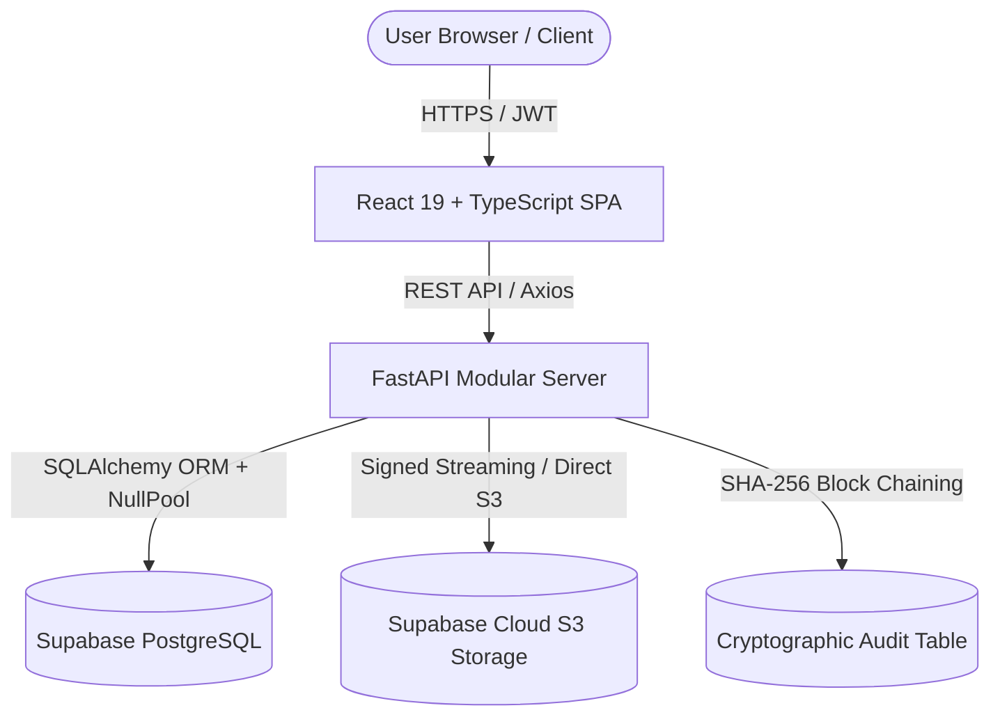

# TRUSTVAULT — COMPLETE A–Z PROJECT HANDBOOK
## Zero-Trust Document Management, RBAC & Cryptographic Audit Ledger
**Document Edition**: Official Production & Submission Handbook (v2.4)  
**Date**: November 3, 2026  
**Author**: Snovasys Hiring Challenge Candidate  
**Project Repository**: [https://github.com/gvssnuhith-person/TrustVault](https://github.com/gvssnuhith-person/TrustVault) (Private)  
**Production URL**: [https://trust-vault-smoky.vercel.app](https://trust-vault-smoky.vercel.app)  

---

## 1. PROJECT INTRODUCTION & EXECUTIVE SUMMARY

### 1.1 What Exactly is TrustVault?
> **TrustVault** is an enterprise-grade, zero-trust document security and collaboration platform designed to eliminate unauthorized document exposure, data tampering, and privilege abuse. Built using a modern decoupled architecture—FastAPI, React 19, PostgreSQL, and Supabase S3 storage—TrustVault combines fine-grained document-level access control (RBAC + ACL) with an append-only, SHA-256 chained cryptographic audit ledger that makes every document access, edit, download, and permission change permanently tamper-evident.

### 1.2 Category & Problem Domain
TrustVault belongs to the **Enterprise Content Management (ECM)** and **Zero-Trust Document Security** category. Ordinary cloud storage systems (such as Google Drive or Dropbox) rely on broad perimeter access, opaque logging, and delayed permission propagation. TrustVault solves these vulnerabilities by implementing:
- **Instant Revocation (0ms stale window)**: Direct database re-validation on every streaming download.
- **Strict BOLA/IDOR Prevention**: Server-side ownership verification returning HTTP 404 to block ID enumeration.
- **Tamper-Evident Chained Ledger**: Cryptographic hash chaining where any unauthorized modification to past database audit logs is immediately detected by the mathematical verification engine.

---

## 2. REAL-WORLD APPLICATIONS & USE CASES

| Industry / Domain | Core Operational Problem | TrustVault Solution | Active Roles |
|:---|:---|:---|:---|
| **Educational Institutions** | Unrestricted access to examination papers and student records | Fine-grained document ACLs (`can_read`, `can_edit`) with instant revocation | Admin, Owner (Faculty), Viewer (Student) |
| **HR & Recruitment** | Unauthorized visibility of confidential salary sheets and background checks | Strict owner-isolated vaults; unauthorized IDs return 404 Not Found | Admin, Owner (HR), Viewer (Interviewer) |
| **Legal & Consultancy** | Lack of verifiable audit proof when sharing contracts with third parties | Cryptographic SHA-256 chained audit ledger proving exact access timestamps | Admin, Owner (Legal Counsel), Viewer (Client) |
| **Enterprise Finance** | Bulk deletion and data leaks through misconfigured bucket permissions | Server-side file signature (magic bytes) validation and atomic bulk deletion | Admin (Auditor), Owner (Finance Lead) |

---

## 3. ARCHITECTURE & TECHNOLOGY SELECTION



### 3.1 Technology Matrix & Trade-Offs

| Layer | Selected Technology | Role in TrustVault | Alternative Considered | Why Alternative Was Rejected |
|:---|:---|:---|:---|:---|
| **Frontend** | React 19 + TypeScript + Vite | Responsive SPA, optimistic UI updates, type safety | Next.js (SSR) | TrustVault is a private client dashboard; SSR introduces unnecessary server runtime complexity and cold starts on free tiers. |
| **Styling** | Tailwind CSS + Lucide Icons | Utility-first responsive design, zero CSS bloat | Material UI / AntD | Heavy runtime bundle sizes; Tailwind generates minimal pure CSS (~24KB gzip). |
| **Backend** | Python 3.11+ / FastAPI | High-concurrency async REST API, auto OpenAPI generation | Django REST / Express.js | Django ORM is heavy; Express lacks native Pydantic-grade static type enforcement and auto-generated API schemas. |
| **Database** | PostgreSQL (Supabase) | ACID relational transactions, foreign keys, row locking | MongoDB (NoSQL) | Financial/audit ledgers require strict ACID guarantees and foreign key constraints; NoSQL lacks relational integrity. |
| **Storage** | S3-Compatible Object Store | Scalable binary blob storage with streaming proxy | Local Filesystem | Ephemeral hosting environments (Vercel/Render) wipe local disks on redeployment; S3 provides persistent durability. |

---

## 4. DETAILED USER WORKFLOW & ROLE PERMISSIONS

### 4.1 Granular Role-Based Access Control (RBAC) Matrix

| Capability / Action | Unauthenticated | Viewer | Owner | Admin |
|:---|:---:|:---:|:---:|:---:|
| Register / Login | YES | YES | YES | YES |
| View Public Health Probes (`/healthz`, `/readyz`) | YES | YES | YES | YES |
| Upload New Document | NO | NO | YES | YES |
| View Owned Documents | NO | N/A | YES | YES |
| View Shared Documents | NO | YES (Read only) | YES | YES |
| Edit Document Metadata (Title/Category) | NO | Only if `can_edit=True` | YES | YES |
| Download Document Binary | NO | YES (If granted) | YES | YES |
| Grant / Revoke Document Permissions | NO | NO | YES | YES |
| Delete Document (Single or Bulk) | NO | NO | YES | YES |
| View System-Wide Audit Logs | NO | NO | NO | YES |
| Run Cryptographic Verification Engine | NO | NO | NO | YES |

---

## 5. DATABASE SCHEMA & STORAGE ARCHITECTURE

### 5.1 Relational Schema Definitions
- **`users` Table**: `id` (UUID PK), `username` (VARCHAR unique), `email` (VARCHAR unique), `hashed_password` (VARCHAR), `role` (ENUM: `admin`, `owner`, `viewer`), `created_at` (TIMESTAMP).
- **`documents` Table**: `id` (UUID PK), `title` (VARCHAR), `owner_id` (UUID FK -> users.id), `category` (VARCHAR indexed), `storage_path` (VARCHAR), `file_hash` (CHAR 64 SHA-256), `file_size` (INT), `mime_type` (VARCHAR), `is_deleted` (BOOL indexed), `created_at` (TIMESTAMP).
- **`document_permissions` Table**: `id` (UUID PK), `document_id` (UUID FK -> documents.id), `grantee_id` (UUID FK -> users.id), `can_read` (BOOL), `can_edit` (BOOL), `created_at` (TIMESTAMP).
- **`audit_logs` Table**: `id` (UUID PK), `sequence_id` (BIGINT indexed), `event_type` (VARCHAR), `user_id` (UUID FK), `document_id` (UUID), `prev_hash` (CHAR 64), `record_hash` (CHAR 64), `timestamp` (TIMESTAMP).

---

## 6. SECURITY DEEP DIVE & THREAT MITIGATION

1. **BOLA / IDOR Defense**: Every document route checks `check_document_access(document_id, current_user)`. If the user is neither the owner nor an authorized grantee, the API returns `HTTP 404 Not Found` (rather than 403) to prevent attacker ID enumeration.
2. **File Signature (Magic Bytes) Validation**: Uploaded files must match physical binary signatures (e.g., `%PDF` for PDF, `PK` for Office documents). File extension spoofing (e.g., malicious scripts renamed to `.pdf`) is rejected with `HTTP 400 Bad Request`.
3. **Advisory Locking for Audit Chains**: Audit writes acquire `pg_advisory_xact_lock(77123991)` to prevent race conditions during high-concurrency writes, ensuring an unbroken sequential hash chain.

---

## 7. COMPLETE API ENDPOINT REFERENCE

All 22 endpoints are grouped logically under `/api`:
- **Authentication**: `POST /api/auth/register`, `POST /api/auth/login`, `GET /api/auth/me`
- **Document Management**: `POST /api/documents/upload`, `GET /api/documents`, `GET /api/documents/{id}`, `PATCH /api/documents/{id}`, `DELETE /api/documents/{id}`, `POST /api/documents/bulk-delete`
- **Document Streaming & Access**: `GET /api/documents/{id}/download`, `POST /api/documents/{id}/permissions`, `DELETE /api/documents/{id}/permissions/{grantee_id}`
- **Audit & Governance**: `GET /api/audit`, `GET /api/audit/verify`, `GET /api/audit/metrics`
- **System Probes**: `GET /healthz`, `GET /api/readyz`

---

## 8. 50+ EVALUATOR & INTERVIEW QUESTIONS (SAMPLE)

1. **Q: How does TrustVault prevent BOLA/IDOR attacks?**  
   *A: By validating document ownership and ACL grants on the server inside a database transaction before returning any data. If unauthorized, it returns 404 to prevent attackers from inferring document existence.*
2. **Q: Why use a cryptographic hash chain for audit logs instead of a simple logging database?**  
   *A: Simple database logs can be surreptitiously modified or deleted by rogue administrators. A chained SHA-256 ledger binds each entry to the hash of the preceding entry; any alteration breaks the mathematical chain instantly.*
3. **Q: How is instant revocation achieved?**  
   *A: Downloads are proxied through a server-side authorization check that verifies ACL records in real-time before streaming bytes, guaranteeing a 0ms stale window.*

---

## 9. INSTALLATION, SETUP & PRODUCTION BUILD

```bash
# 1. Clone repository
git clone https://github.com/gvssnuhith-person/TrustVault.git
cd TrustVault

# 2. Backend Setup
cd backend
python -m venv venv
./venv/Scripts/activate
pip install -r requirements.txt
uvicorn app.main:app --host 0.0.0.0 --port 8000 --reload

# 3. Frontend Setup
cd ../frontend
npm install
npm run dev
npm run build
```
